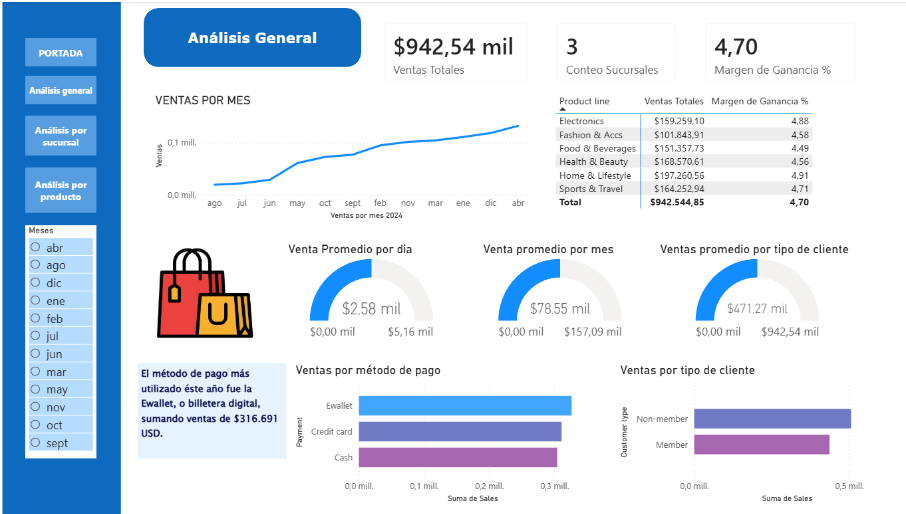
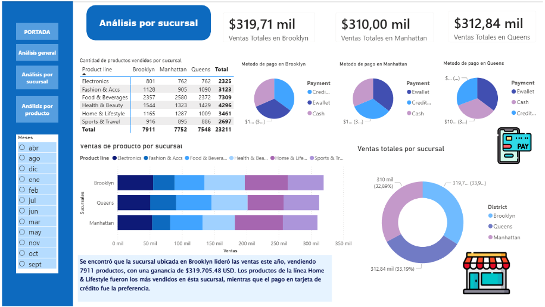
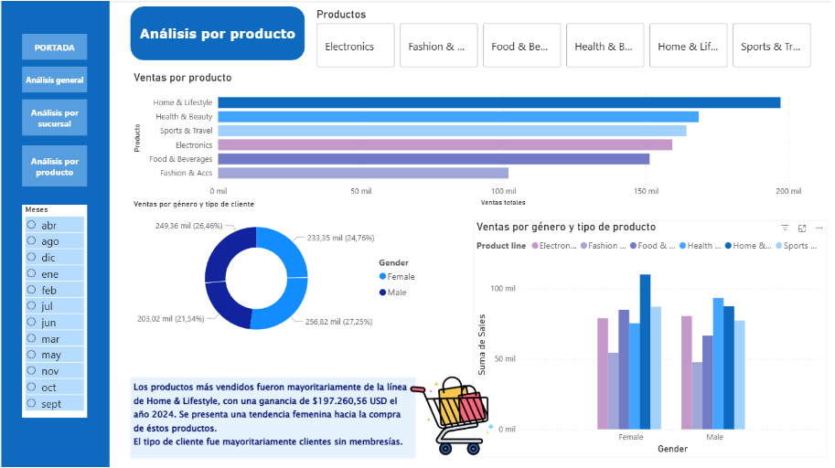

# PowerBI NY Supermarket Sales Analysis

## Author
GabyDotDev 
Data Analyst | Power BI | Data Analytics  
CoderHouse – Data Analytics (Commission 89485)  
March 2026  

---

## Project Overview

This project presents a data analysis of supermarket sales in New York (2024), developed using Power BI. The objective is to explore sales performance, customer behavior, and key business metrics through an interactive dashboard.

---

## Tech Stack


---

## Dataset

The dataset includes:

- Sales transactions  
- Product categories  
- Customer information (type and gender)  
- Payment methods  
- Financial data (total, tax, margin)  
- Time variables (date, month, quarter)  

---

## Business Objectives

- Identify top-performing branches  
- Analyze revenue by product category  
- Evaluate payment method usage  
- Explore customer segmentation  
- Understand sales trends over time  

---

## Key Metrics (Power BI)

- Total Revenue  
- Revenue by Branch  
- Revenue by Category  
- Sales by Payment Method  
- Average Sales (Monthly / Daily)  
- Customer Segmentation  
- Time-based Analysis  

---

## Dashboard Preview





---

## Key Insights

- Clear differences in revenue across branches  
- Certain product categories dominate total sales  
- Payment method preferences show consistent patterns  
- Sales trends reveal temporal variations  
- Customer segmentation provides behavioral insights  

---

## Repository Structure

```
/dataset
/powerbi
/assets
/reporte
README.md
```

---

## How to Use

1. Download the Project `.pbix` file
2. Download the database NY_supermarket_sales_2024 `.xlsx`
3. Open it using Power BI Desktop and export the tables  
4. Explore the interactive dashboard  

---

## Keywords

Data Analysis, Power BI, Dashboard, Data Visualization, Business Intelligence, KPI, Data Analytics, Reporting, Insights

---

## Contact

Email: ga.faundezn@gmail.com  
GitHub: https://github.com/gabrieladotdev  
